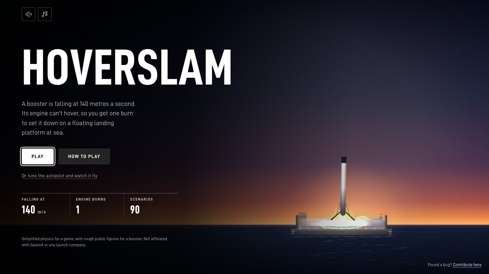
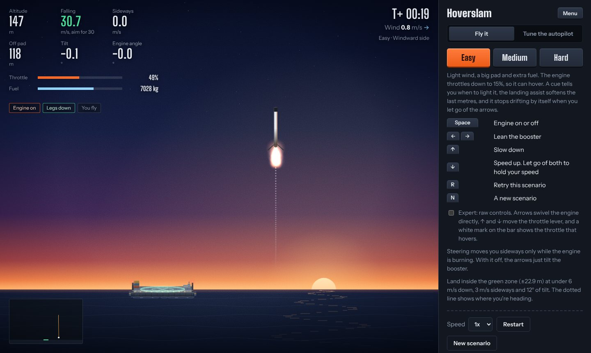
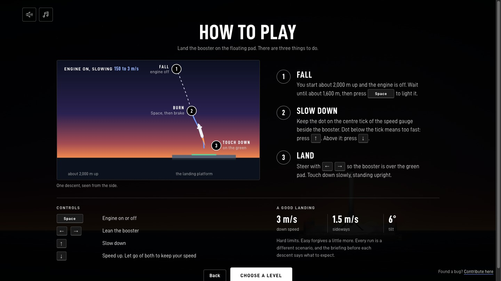
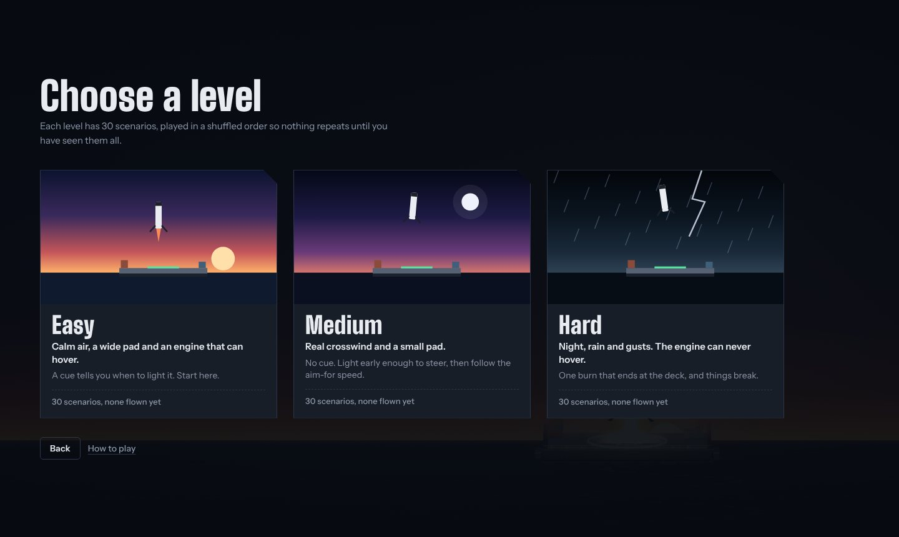
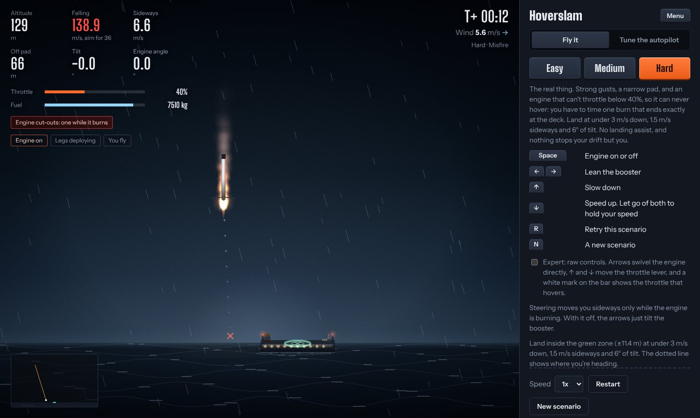
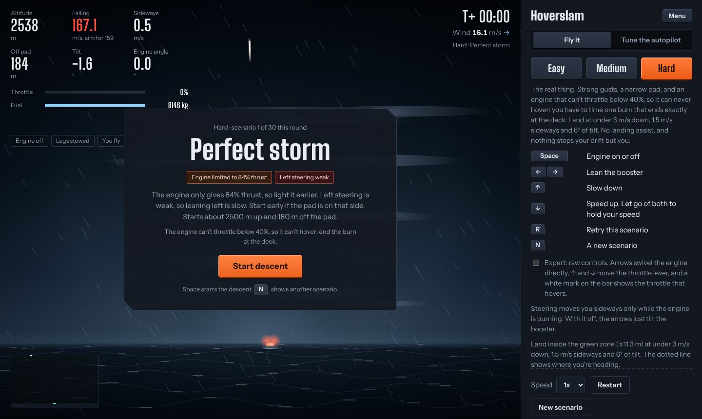
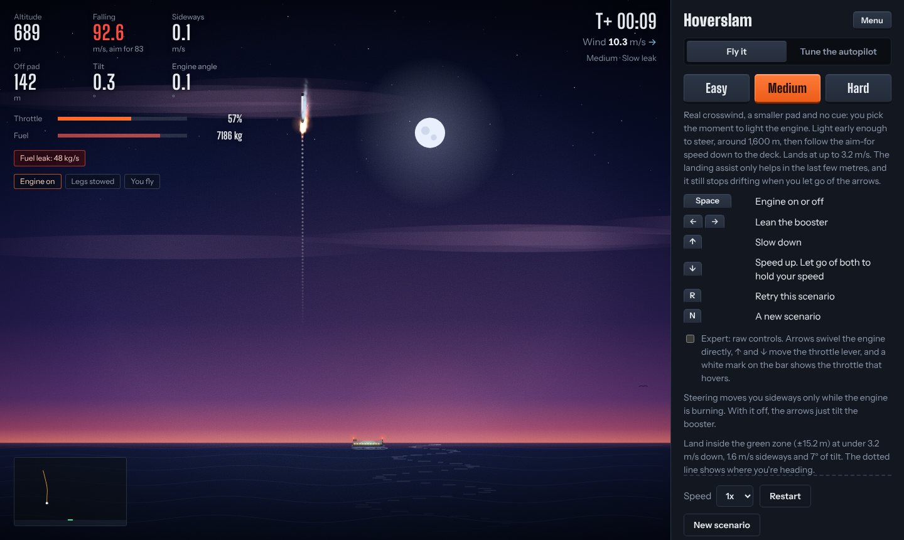
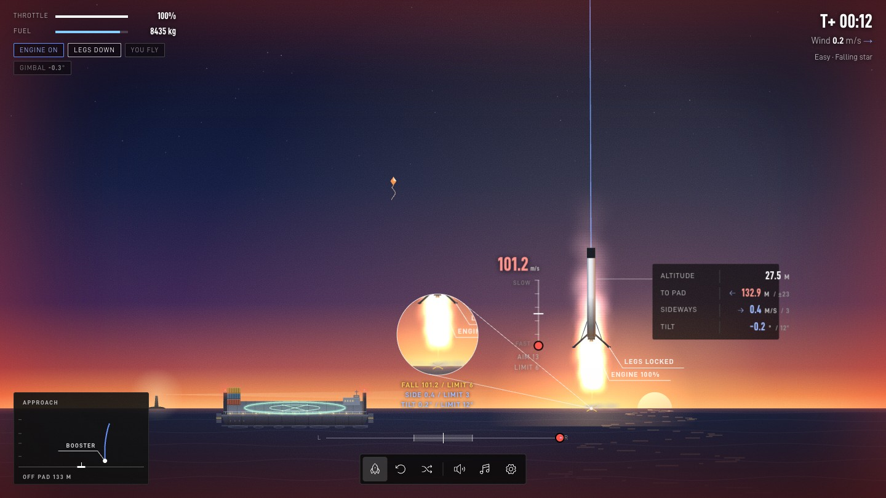
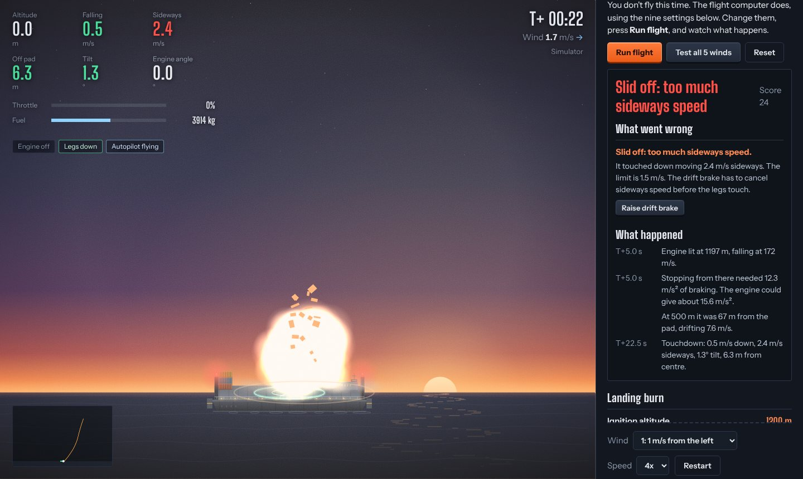
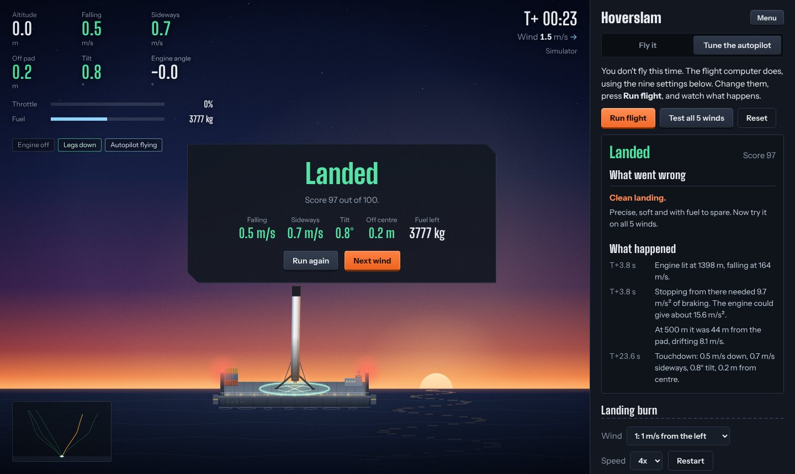

# Hoverslam

**Land a rocket booster on a floating landing platform. Fly it yourself on three levels, where every run is a different scenario, or tune the autopilot and see why a landing failed.**

[**Play it: hoverslam.vercel.app**](https://hoverslam.vercel.app) · No install, no account, built for a laptop with a keyboard; touch controls are a bonus on a phone.





A booster is falling toward a floating landing platform at sea at about 140 m/s. Land it upright, slowly, on the pad. The real engine can't throttle below 40%, so a nearly empty booster can't hover: the burn has to end right at the deck. That manoeuvre is called a hoverslam.

## Two modes

### Fly it (the game)

You are the flight computer.

| Key | What it does |
| --- | --- |
| Space | Engine on or off |
| ← → | Lean the booster. On Easy and Medium it stops drifting by itself when you let go |
| ↑ | Slow down |
| ↓ | Speed up. Let go of both to hold your falling speed |
| R | Retry this scenario |
| N | A new scenario |

On a phone you get touch buttons in two thumb clusters (lean on the left, throttle and engine on the right), and it works in portrait or landscape. The **Expert** checkbox swaps in raw controls: the arrows swivel the engine directly and ↑/↓ move a throttle lever.

| Level | What changes |
| --- | --- |
| Easy | Light wind, wide pad, extra fuel, the engine throttles to 15% so it can hover, a cue says when to light it, a landing assist softens the last metres, and it stops drifting when you let go. Lands at up to 6 m/s |
| Medium | Real crosswind, 14 m pad, no cue, 30% minimum throttle (it can hover until the tank is nearly empty), landing assist only in the last few metres, drift hold on. Lands at up to 3.2 m/s down, 1.6 m/s sideways, 6.5° tilt |
| Hard | Strong gusts, 11 m pad, the real 40% minimum throttle (it can never hover), no assist, no drift hold. You time one burn that ends at the deck. Lands at up to 3 m/s down, 1.5 m/s sideways, 6° tilt |

The first screen is a how-to-play page with a diagram of a whole descent and the controls, then three level cards. The look is original: a sunset, a moonlit dusk and a night storm, with gulls over the water and a landing platform modelled on a real drone ship.





Each level has its own look: Easy is a sunset, Medium is dusk with a moon, and Hard is a night storm with rain, lightning and a landing platform lit only by its own lights.



### A new scenario every time

Each level has a bank of 30 scenarios, and every play draws the next one from a shuffled bag. All 30 come up once, in random order, before any repeat, and you never get the same one twice in a row. Before each descent a briefing card says what is different this time: a long fall, a fuel leak, an engine that only gives 80% thrust, a flaky left thruster. Pick **Retry this one** to have another go, or **New scenario** (or press N) for a fresh one. The game remembers how many you have cleared.



| Level | What varies |
| --- | --- |
| Easy | The start: low or high, near or far, a calm day or a breeze. No faults |
| Medium | A bit more of everything, and usually one fault: a heavy fuel leak, an engine limited to about 60–75% thrust, or one brief engine cut-out |
| Hard | Strong gusts and one or two faults: a fast leak, an engine limited to about 60–74% thrust, engine cut-outs (up to four, spread over the whole burn, sometimes one near the deck, sometimes a quick stutter), or very weak (sometimes flickering) steering on one side. About half the scenarios have cut-outs, and some give no warning |

Most faults are shown on screen, with a chip under the readouts, a flashing fuel bar for a leak, and a chip naming the fault. Engine cut-outs are silent: the engine just stops, with no pop-up to distract you. On some Hard scenarios the briefing doesn't mention them at all. So a loss feels like the challenge and not a bug.



**Where the scenarios come from.** A scenario is a small piece of data: a name, a briefing, a seed, a few numbers (start height, distance, wind, fuel, pad size) and up to two faults. Every scenario must pass two checks before it can enter the bank: its numbers must sit inside the level's allowed ranges, and the simulator must be able to land it (Easy by a player who only lights the engine and steers; Medium by a player using only the keys, lighting the engine at 1,400 to 1,800 m and following the aim-for speed; Hard by that same key player and by the flight computer). The bank in `public/bank.js` was made by rules. To add more, run:

```
npm run scenarios                     # top the bank up from rules, no key needed
npm run scenarios -- --claude         # also ask Claude to write scenarios
npm run scenarios -- --per-level 50   # a bigger bank
```

For `--claude`, copy `.env.example` to `.env.local` and paste an Anthropic API key (the file is git-ignored). Claude writes the scenario data; the simulator still checks every one, so a bad or unwinnable scenario is dropped before it can reach a player. Scenarios are generated ahead of time in batches, not when you press a button, so playing is instant and the cost is predictable.



### Tune the autopilot (the simulator)

The flight computer flies, using nine settings you choose. Press **Run flight** and watch. Afterwards it explains what went wrong using that flight's own numbers (for example, "stopping needed 12.3 m/s² of braking; the engine could give 15.6") and offers a button that nudges the setting to change. **Test all 5 winds** scores your settings on every wind.



| Setting | What it does |
| --- | --- |
| Ignition altitude | Height where the landing burn starts |
| Braking strength | How hard the speed plan brakes on the way down |
| Touchdown speed | Speed the plan aims for when the legs touch |
| Speed correction | How hard the throttle reacts when off the plan |
| Pad pull | How far it leans toward the pad per metre off centre |
| Drift brake | How far it leans against sideways drift |
| Max lean | Steepest lean allowed while steering |
| Attitude stiffness | How hard the engine swivels to reach the wanted lean |
| Attitude damping | How strongly it resists rotating (stops wobble) |



## How it works

A 2D rigid body stepped 120 times a second. Engine gimbal ±7° at 20°/s, throttle with 0.25 s lag, fuel burn from an Isp of 282 s, drag that thins with altitude, a seeded crosswind with gusts that fade near the surface, and small cold-gas thrusters for turning. The autopilot follows a braking speed plan v = −√(c² + 2ah) with feed-forward, leans toward the pad from its offset and drift, and holds attitude with a PD loop.

Sound is generated in the browser, so there is nothing to download or license. The engine's tone follows the throttle and stops dead when it cuts, the rush of air follows your falling speed, and each level has its own weather. Effects are on by default, music is off. Both toggles are in the corner and are remembered, and `M` toggles sound effects.

| File | What it holds |
| --- | --- |
| `public/physics.js` | The simulation, the levels, the autopilot and the scoring |
| `public/controls.js` | The keyboard controls for the game |
| `public/scenario.js` | Scenario rules and checks, fault labels and the shuffle bag |
| `public/bank.js` | The scenario bank (generated) |
| `public/explain.js` | Plain-language help for each setting and the flight debrief |
| `public/app.js` | The renderer, HUD, panels and start screens |
| `public/menu.js` | The how-to-play diagrams and level cards |
| `public/audio.js` | The sound, all synthesised with Web Audio (no audio files) |
| `scripts/test.mjs` | The tests |
| `scripts/generate-scenarios.mjs` | Builds the scenario bank, by rules or with Claude |
| `scripts/lib/` | The scripted players, the rule-based writer and the Claude writer |

## Run it

```
git clone https://github.com/rushilbh27/hover-slam.git
cd hover-slam
npm start
```

Open http://localhost:3000. There are no dependencies to install (Node 18 or newer). `npm run build` writes `dist/hoverslam.html`, a single file that opens straight from disk.

## Tests

```
npm test
```

53 checks, no browser needed:

- **Physics:** the same wind gives the same flight, fuel never goes negative, and a nearly empty booster at the real 40% throttle floor climbs.
- **Faults:** a leak drains fuel at its rate, a thrust cap really limits thrust, engine cut-outs stop the thrust and are spread over the whole burn, a low cut-out fires once near the deck and a stutter is four quick cuts, a weak side turns slower than the other, and a flickering side drops out. A flight with no faults is exactly what it was before.
- **Autopilot:** the reference settings land every wind and the starting settings don't. Scoring and the settings validator behave.
- **Explanations:** every setting has a plain-language description, and the debrief names the right cause for late ignition, a too-low touchdown speed, too little damping and ignoring the pad.
- **Game controls:** a scripted player who never touches ↑ or ↓ wins every Easy wind, but never wins Medium or Hard. The lean builds up smoothly with no jump or overshoot, the arrows work with the engine off, letting go stops sideways drift, and the booster never climbs when the keys are left alone.
- **Medium and Hard:** a key-only player who follows the on-screen aim-for speed can land Medium, and Hard's key-only player lands at least one lighting height for every scenario.
- **Scenarios:** the validator rejects out-of-range numbers, too many faults and faults a level doesn't allow. The bank has at least 24 valid scenarios per level with unique ids, seeds and names, a real mix of faults, and every one can be won. The shuffle bag plays all of them before repeating and never repeats back to back.
- **Claude as a scenario writer:** against a fake API, it sends the right request, keeps valid scenarios, drops invalid ones with a reason, retries once on bad output, and fails clearly when nothing valid comes back.
- **Build:** the single-file build is valid JavaScript and contains the bank.

## Notes

Simplified physics for a game, with rough public figures for a booster. Not affiliated with SpaceX or any launch company.

[MIT licence](LICENSE)
