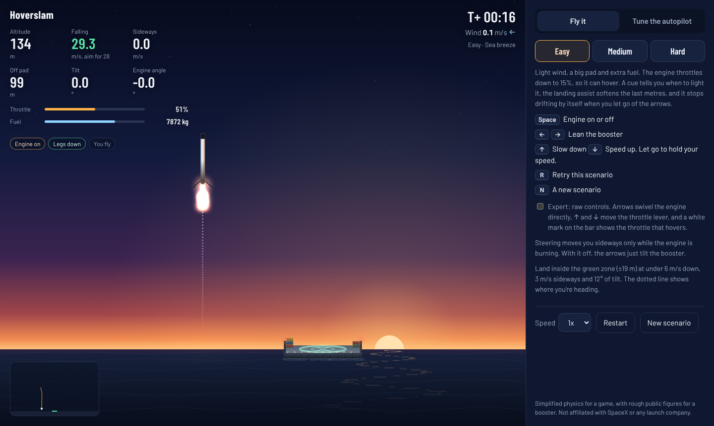
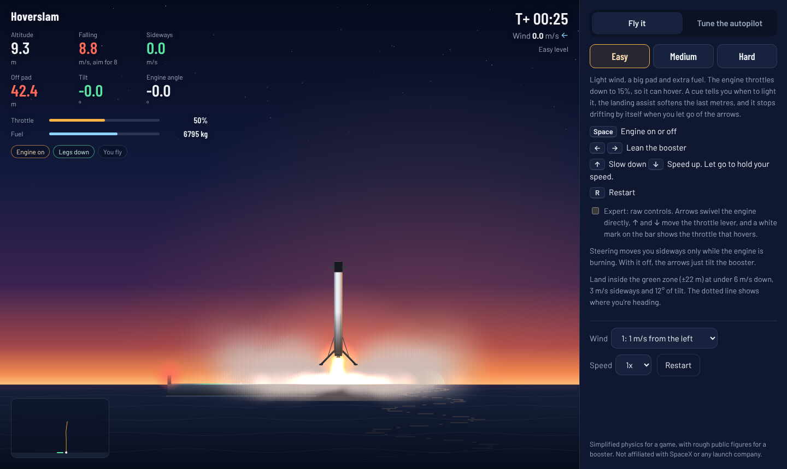
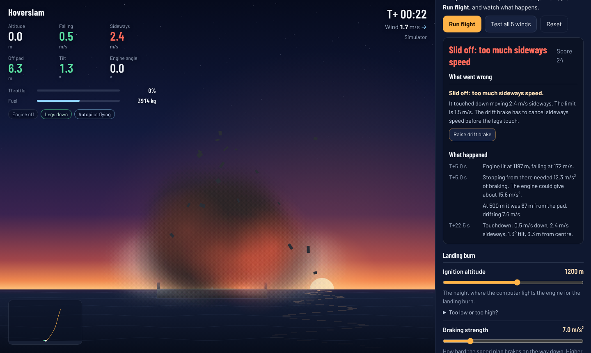
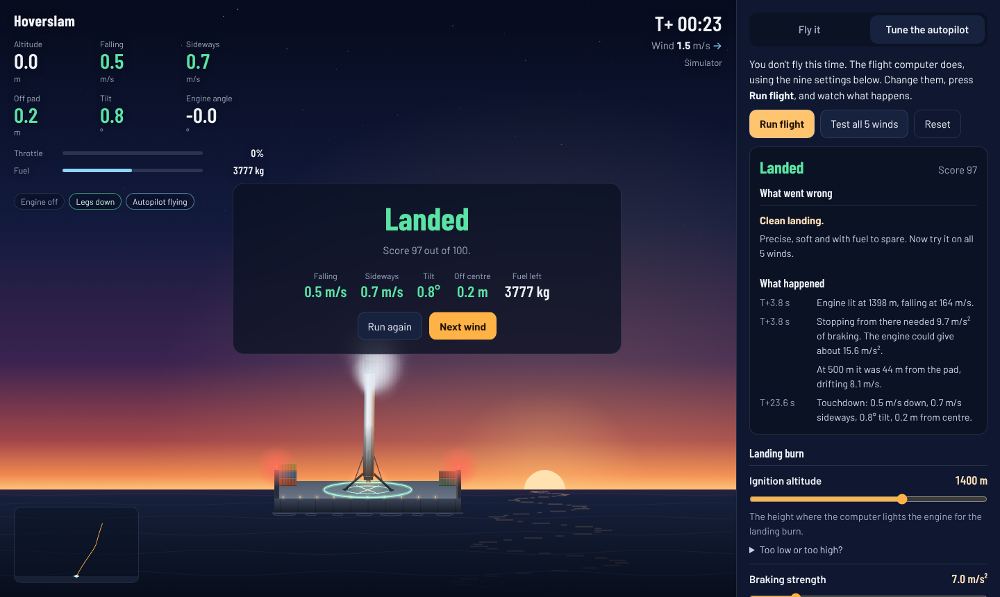

# Hoverslam

**Land a rocket booster on a barge. Fly it yourself on three levels, or tune the autopilot and see why a landing failed.**

[**Play it: hoverslam.vercel.app**](https://hoverslam.vercel.app) · No install, no account, works on a phone.



A booster is falling toward a barge at sea at about 140 m/s. Land it upright, slowly, on the pad. The real engine can't throttle below 40%, so a nearly empty booster can't hover: the burn has to end right at the deck. That manoeuvre is called a hoverslam.

## Two modes

### Fly it (the game)

You are the flight computer.

| Key | What it does |
| --- | --- |
| Space | Engine on or off |
| ← → | Lean the booster. On Easy and Medium it stops drifting by itself when you let go |
| ↑ | Slow down |
| ↓ | Speed up. Let go of both to hold your falling speed |
| R | Restart |

Phones get touch buttons. The **Expert** checkbox swaps in raw controls: the arrows swivel the engine directly and ↑/↓ move a throttle lever.

| Level | What changes |
| --- | --- |
| Easy | Light wind, wide pad, extra fuel, the engine throttles to 15% so it can hover, a cue says when to light it, a landing assist softens the last metres, and it stops drifting when you let go. Lands at up to 6 m/s |
| Medium | Real crosswind, 14 m pad, no cue, 35% minimum throttle, landing assist only in the last few metres, drift hold on. Lands at up to 3.2 m/s down, 1.6 m/s sideways, 6.5° tilt |
| Hard | Strong gusts, 11 m pad, the real 40% minimum throttle (it can never hover), no assist, no drift hold. You time one burn that ends at the deck. Lands at up to 3 m/s down, 1.5 m/s sideways, 6° tilt |



### Tune the autopilot (the simulator)

The flight computer flies, using nine settings you choose. Press **Run flight** and watch. Afterwards it explains what went wrong using that flight's own numbers (for example, "stopping needed 12.3 m/s² of braking; the engine could give 15.6") and offers a button that nudges the setting to change. **Test all 5 winds** scores your settings on every wind.



| Setting | What it does |
| --- | --- |
| Ignition altitude | Height where the landing burn starts |
| Braking strength | How hard the speed plan brakes on the way down |
| Touchdown speed | Speed the plan aims for when the legs touch |
| Speed correction | How hard the throttle reacts when off the plan |
| Pad pull | How far it leans toward the pad per metre off centre |
| Drift brake | How far it leans against sideways drift |
| Max lean | Steepest lean allowed while steering |
| Attitude stiffness | How hard the engine swivels to reach the wanted lean |
| Attitude damping | How strongly it resists rotating (stops wobble) |



## How it works

A 2D rigid body stepped 120 times a second. Engine gimbal ±7° at 20°/s, throttle with 0.25 s lag, fuel burn from an Isp of 282 s, drag that thins with altitude, a seeded crosswind with gusts that fade near the surface, and small cold-gas thrusters for turning. The autopilot follows a braking speed plan v = −√(c² + 2ah) with feed-forward, leans toward the pad from its offset and drift, and holds attitude with a PD loop.

| File | What it holds |
| --- | --- |
| `public/physics.js` | The simulation, the levels, the autopilot and the scoring |
| `public/controls.js` | The keyboard controls for the game |
| `public/explain.js` | Plain-language help for each setting and the flight debrief |
| `public/app.js` | The renderer, HUD and panels |
| `scripts/test.mjs` | The tests |

## Run it

```
git clone https://github.com/rushilbh27/hover-slam.git
cd hover-slam
npm start
```

Open http://localhost:3000. There are no dependencies to install. `npm run build` writes `dist/hoverslam.html`, a single file that opens straight from disk.

## Tests

```
npm test
```

23 checks, no browser needed:

- **Physics:** the same wind gives the same flight, fuel never goes negative, and a nearly empty booster at the real 40% throttle floor climbs.
- **Autopilot:** the reference settings land every wind and the starting settings don't. Scoring and the settings validator behave. Every level can be won: the reference autopilot lands most winds even on Hard.
- **Explanations:** every setting has a plain-language description, and the debrief names the right cause for late ignition, a too-low touchdown speed, too little damping and ignoring the pad.
- **Game controls:** a scripted player who never touches ↑ or ↓ wins every Easy wind, but never wins Medium or Hard. A careful player wins every Easy wind and about half the Medium winds. The lean builds up smoothly with no jump or overshoot, the arrows work with the engine off, letting go stops sideways drift, and the booster never climbs when the keys are left alone.

## Notes

Simplified physics for a game, with rough public figures for a booster. Not affiliated with SpaceX or any launch company.

[MIT licence](LICENSE)
